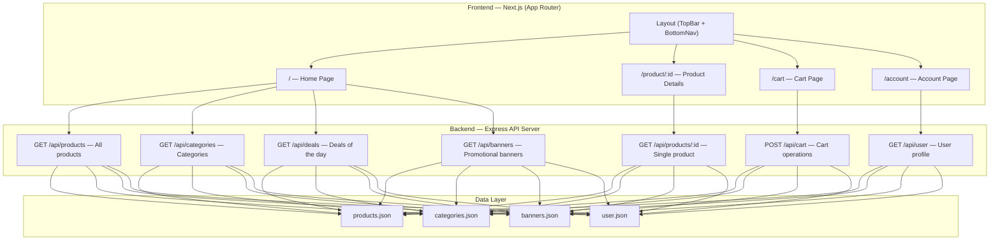

# PulseKart E-Commerce App — Implementation Plan

## Goal Description

Build a **PulseKart** e-commerce mobile-first responsive web application based on the provided Flipkart-inspired design screenshots. The app includes 4 core pages — **Home**, **Product Details**, **Cart**, and **Account/Profile** — powered by **Next.js** (App Router) on the frontend and a **Node.js/Express** REST API backend with mock JSON data.

The design language features:
- White/light backgrounds with **orange (#FF6200)** and **blue (#2874F0)** as primary accent colors
- Bold typography, discount badges, star ratings
- Card-based product layouts, horizontal scroll carousels
- Sticky bottom navigation bar with 5 tabs (Home, Categories, Notifications, Account, Cart)
- Sticky top bar with search, voice, and camera icons

---

## User Review Required

> [!IMPORTANT]
> **Brand Name**: The app will be called **PulseKart** as shown in the design. Confirm if you'd like a different name.

> [!IMPORTANT]
> **Authentication**: The Account page shows a logged-in user (Rahul Sharma). For v1, we'll use **hardcoded mock user data** — no real auth. Should we add login/signup UI pages as well?

> [!IMPORTANT]
> **Express API Backend**: We'll create a separate `/api-server` directory inside the project for the Express backend. The Next.js frontend will fetch data from this API. Both will run concurrently during development.

---

## Open Questions

> [!NOTE]
> **Categories Page**: The bottom nav shows a "Categories" tab. Should we create a basic categories grid page, or leave it as a placeholder for v1?

> [!NOTE]
> **Notifications Page**: Similarly, should we build a notifications page or leave it as a placeholder?

> [!NOTE]
> **Checkout/Payment Flow**: The cart page shows a 3-step progress (Cart → Address → Payment). Should we build address/payment pages, or just the cart for v1?

---

## Architecture Overview



---

## Project Structure

```
e-com/
├── api-server/                    # Express backend
│   ├── package.json
│   ├── server.js                  # Express app entry
│   ├── routes/
│   │   ├── products.js
│   │   ├── categories.js
│   │   ├── banners.js
│   │   ├── cart.js
│   │   └── user.js
│   └── data/
│       ├── products.json
│       ├── categories.json
│       ├── banners.json
│       └── user.json
│
├── src/                           # Next.js frontend
│   ├── app/
│   │   ├── layout.js              # Root layout (TopBar + BottomNav)
│   │   ├── page.js                # Home page
│   │   ├── globals.css            # Global styles + design tokens
│   │   ├── product/
│   │   │   └── [id]/
│   │   │       └── page.js        # Product details page
│   │   ├── cart/
│   │   │   └── page.js            # Cart page
│   │   └── account/
│   │       └── page.js            # Account/Profile page
│   │
│   ├── components/
│   │   ├── layout/
│   │   │   ├── TopBar.js          # Search bar header
│   │   │   ├── TopBar.module.css
│   │   │   ├── BottomNav.js       # Bottom navigation
│   │   │   └── BottomNav.module.css
│   │   │
│   │   ├── home/
│   │   │   ├── CategoryBar.js     # Horizontal category icons
│   │   │   ├── CategoryBar.module.css
│   │   │   ├── PromoBanner.js     # "Big Pulse Days" banner
│   │   │   ├── PromoBanner.module.css
│   │   │   ├── BankOffer.js       # Bank offer strip
│   │   │   ├── BankOffer.module.css
│   │   │   ├── DealsSection.js    # Deals of the Day carousel
│   │   │   ├── DealsSection.module.css
│   │   │   ├── SuperCoinBanner.js # SuperCoin zone banner
│   │   │   ├── SuperCoinBanner.module.css
│   │   │   ├── TrendingSection.js # Trending in Electronics grid
│   │   │   └── TrendingSection.module.css
│   │   │
│   │   ├── product/
│   │   │   ├── ImageCarousel.js   # Product image slider
│   │   │   ├── ImageCarousel.module.css
│   │   │   ├── ProductInfo.js     # Title, rating, price
│   │   │   ├── ProductInfo.module.css
│   │   │   ├── BankOffers.js      # Available bank offers
│   │   │   ├── BankOffers.module.css
│   │   │   ├── ColorVariants.js   # Color selector
│   │   │   ├── ColorVariants.module.css
│   │   │   ├── DeliveryInfo.js    # Delivery & services
│   │   │   ├── DeliveryInfo.module.css
│   │   │   ├── KeyHighlights.js   # Product highlights list
│   │   │   ├── KeyHighlights.module.css
│   │   │   └── WarrantyBadges.js  # 7 Days Replacement, etc.
│   │   │
│   │   ├── cart/
│   │   │   ├── CartProgress.js    # Step indicator (Cart→Address→Payment)
│   │   │   ├── CartProgress.module.css
│   │   │   ├── CartItem.js        # Individual cart item card
│   │   │   ├── CartItem.module.css
│   │   │   ├── CouponSection.js   # SuperCoins + Coupon code
│   │   │   ├── CouponSection.module.css
│   │   │   ├── PriceDetails.js    # Price breakdown
│   │   │   ├── PriceDetails.module.css
│   │   │   └── CartFooter.js      # Sticky bottom (Total + Place Order)
│   │   │
│   │   └── account/
│   │       ├── UserHeader.js      # Profile pic, name, phone
│   │       ├── UserHeader.module.css
│   │       ├── QuickLinks.js      # Orders, Wishlist, Coupons, Help
│   │       ├── QuickLinks.module.css
│   │       ├── OrderTracking.js   # Arriving Tomorrow section
│   │       ├── OrderTracking.module.css
│   │       ├── PulsePay.js        # PulsePay Later card
│   │       ├── PulsePay.module.css
│   │       ├── SellerHub.js       # Seller Hub dark card
│   │       ├── SellerHub.module.css
│   │       └── AccountSettings.js # Settings list
│   │
│   ├── context/
│   │   └── CartContext.js         # React Context for cart state
│   │
│   ├── hooks/
│   │   └── useApi.js              # Custom hook for API calls
│   │
│   └── utils/
│       └── formatPrice.js         # ₹ currency formatter
│
├── public/
│   └── images/                    # Generated product/UI images
│
├── package.json
├── next.config.js
└── jsconfig.json
```

---

## Proposed Changes

### 1. Project Initialization

#### [NEW] Next.js App Setup
```bash
npx -y create-next-app@latest ./ --js --app --src-dir --no-tailwind --eslint --use-npm --yes
```
- JavaScript (no TypeScript)
- App Router
- `src/` directory structure
- No Tailwind CSS (vanilla CSS)
- ESLint enabled

#### [NEW] Express API Server Setup
```bash
mkdir api-server && cd api-server
npm init -y
npm install express cors
```

---

### 2. Design System & Global Styles

#### [NEW] `src/app/globals.css`

Design tokens extracted from the screenshots:

```css
:root {
  /* Brand Colors */
  --color-primary-blue: #2874F0;
  --color-primary-orange: #FF6200;
  --color-accent-yellow: #FFE11B;
  --color-accent-green: #388E3C;
  --color-accent-red: #FF1744;
  
  /* Neutrals */
  --color-bg-primary: #FFFFFF;
  --color-bg-secondary: #F1F3F6;
  --color-bg-dark: #1C2534;
  --color-text-primary: #212121;
  --color-text-secondary: #878787;
  --color-text-white: #FFFFFF;
  --color-border: #E0E0E0;
  
  /* Typography */
  --font-family: 'Inter', -apple-system, sans-serif;
  --font-size-xs: 10px;
  --font-size-sm: 12px;
  --font-size-md: 14px;
  --font-size-lg: 16px;
  --font-size-xl: 18px;
  --font-size-2xl: 22px;
  --font-size-3xl: 28px;
  
  /* Spacing */
  --space-xs: 4px;
  --space-sm: 8px;
  --space-md: 12px;
  --space-lg: 16px;
  --space-xl: 20px;
  --space-2xl: 24px;
  
  /* Border Radius */
  --radius-sm: 4px;
  --radius-md: 8px;
  --radius-lg: 12px;
  --radius-xl: 16px;
  --radius-pill: 999px;
  
  /* Shadows */
  --shadow-sm: 0 1px 3px rgba(0,0,0,0.08);
  --shadow-md: 0 2px 8px rgba(0,0,0,0.12);
  --shadow-lg: 0 4px 16px rgba(0,0,0,0.16);
  
  /* Bottom nav height for padding */
  --bottom-nav-height: 56px;
  --top-bar-height: 108px;
}
```

---

### 3. Layout Components

#### [NEW] `TopBar.js` — Sticky Search Header
Based on the design, the top bar contains:
- PulseKart logo (left)
- Search input with placeholder "Search for Products, Brands and More"
- Microphone and Camera icons (right of search)
- Notification bell and profile avatar (top right)
- Delivery address strip below search

```
┌──────────────────────────────────────┐
│ 🔵 PulseKart          🔔  👤        │
│ 🔍 Search for Products...   🎤 📷   │
│ 📍 Deliver to Rahul, 560034  Change>│
└──────────────────────────────────────┘
```

#### [NEW] `BottomNav.js` — Sticky Bottom Navigation
5-tab navigation with icons and labels:
- **Home** (house icon) — active state: blue, bold
- **Categories** (grid icon)
- **Notifications** (bell icon)  
- **Account** (person icon)
- **Cart** (shopping cart icon) — with badge count

```
┌──────────────────────────────────────┐
│  🏠      ≡       🔔      👤     🛒  │
│ Home  Category  Notifs  Account Cart │
└──────────────────────────────────────┘
```

---

### 4. Home Page Components

#### [NEW] `CategoryBar.js`
Horizontal scrollable category chips with icons:
- Top Offers, Mobiles, Electronics, Fashion, Appliances, Grocery
- Each has a circular icon container with subtle shadow

#### [NEW] `PromoBanner.js`
- "BIG PULSE DAYS" tag with countdown timer (08h:42m:10s left)
- Orange gradient background
- "Up to 80% Off" headline
- "Top Smartphones & Hi-Fi Audio" subtitle
- "Shop Now →" CTA button

#### [NEW] `BankOffer.js`
- Horizontal strip with bank icon
- "Bank Offer: 10% Instant Discount On HDFC Bank & SBI Credit Cards"
- T&C link on right

#### [NEW] `DealsSection.js`
- Header: "Deals of the Day" with "Fresh discounts every 24 hours" subtitle
- "View All >" link
- Horizontal scroll carousel of product cards
- Each card: image, discount badge (e.g., "64% off"), title, rating (stars + count), price (strikethrough original), "Free delivery" tag

#### [NEW] `SuperCoinBanner.js`
- Dark rounded card with yellow coin icon
- "SuperCoinZone PLUS" text
- "Earn 50 SuperCoins + Free Express Delivery"
- Green "Explore" button

#### [NEW] `TrendingSection.js`
- Header: "🔥 Trending in Electronics" with "Best Value" tag
- 2-column grid of product cards
- Each card: image, discount tag (e.g., "Min 40% Off"), title, price/description
- "⚡ Free by Tomorrow" delivery tag

---

### 5. Product Details Page

#### [NEW] `ImageCarousel.js`
- Full-width product image with swipe dots
- Heart (wishlist) icon top-right
- Share icon below heart
- "PULSE ASSURED" badge bottom-left
- Image counter "1/5" bottom-right

#### [NEW] `ProductInfo.js`
- "TOP DEAL" badge + "Hot in Audio Gear" category
- Product title (multi-line)
- Rating: ★ 4.4 with green background, "38,912 ratings & 4,120 reviews"
- Price: ₹2,499 with strikethrough ₹6,999, "64% off" green text
- "🚚 Free delivery by Tomorrow, 2 PM" green highlight

#### [NEW] `BankOffers.js`
- "Available Bank Offers" header with "5 OFFERS" link
- List of offers with bank icons:
  - HDFC Credit Card EMI ₹1,600
  - PulseKart Axis Bank Card cashback
  - Special Price ₹500 off

#### [NEW] `ColorVariants.js`
- "Color: Matte Obsidian" label + "3 Variants in stock"
- Horizontal color swatches (Matte Obsidian, Arctic Silver, Navy Blue)
- Active swatch has border highlight

#### [NEW] `DeliveryInfo.js`
- "Delivery & Services" header + "⚡ Fastest Delivery" tag
- Pincode input with "Check" button
- "Delivery to 560034" with estimated time
- "Free Delivery by Tomorrow if ordered within 2 hrs 48 mins"

#### [NEW] `KeyHighlights.js`
- Bullet list of product features
- Clean checkmark or bullet styling

#### [NEW] `WarrantyBadges.js`
- 3 horizontal badges: "7 Days Replacement", "Cash on Delivery Available", "1 Year Brand Warranty"
- Each with an icon

#### Sticky Bottom Bar
- "Add to Cart" button (white/outlined)
- "Buy Now" button (orange, filled)

---

### 6. Cart Page

#### [NEW] `CartProgress.js`
- 3-step horizontal progress: **1 Cart** → **2 Address** → **3 Payment**
- Active step (1) highlighted in blue
- Connected with lines

#### [NEW] `CartItem.js`
- Product thumbnail + "Assured" badge
- Product name, seller, color variant
- Price with discount: ₹2,499 ~~₹6,999~~ 64% off
- Delivery info: "Tomorrow, 2 PM | Free"
- Quantity controls: − 1 + buttons
- "Save for later" and "Remove" actions

#### [NEW] `CouponSection.js`
- SuperCoins toggle: "Use 100 SuperCoins to save ₹100" with balance
- Coupon code input with "Applied" state
- Green checkmark: "Coupon 'PULSEFIRST' applied (-₹200 discount)"

#### [NEW] `PriceDetails.js`
- Table-like layout:
  - Price (2 items): ₹7,998
  - Discount: -₹5,150
  - SuperCoin Savings: -₹100
  - Coupons: -₹200
  - Protect+ Fee: ₹0 (Free)
  - Delivery: ~~₹80~~ FREE
- **Total Amount: ₹2,548** (bold)
- Green savings banner: "You will save ₹5,450 on this order!"
- Trust badges: "100% Authentic", "Easy Returns"

#### [NEW] `CartFooter.js`
- Sticky bottom bar
- Left: ₹2,548 ~~₹7,998~~ with "View Price Details ^"
- Right: Green "Place Order →" button

---

### 7. Account/Profile Page

#### [NEW] `UserHeader.js`
- Profile avatar (circular)
- Name: "Rahul Sharma"
- Phone: "+91 98765 43210"
- Edit icon (pencil)
- "✓ Pulse Plus Member" green badge

#### [NEW] `QuickLinks.js`
- 2×2 grid cards:
  - **My Orders** (📦): "Track, cancel, b..." with arrow
  - **Wishlist** (❤️): "12 items saved" with orange accent
  - **Coupons** (🏷️): "4 available"
  - **Help Centre** (❓): "24×7 Assistance"

#### [NEW] `OrderTracking.js`
- "Arriving Tomorrow by 2 PM" with "On Schedule" green tag
- Product thumbnail with order details
- Progress bar: Ordered → Packed → **Shipped** → Delivery
- "Track Item" blue button + "Need Help?" outlined button

#### [NEW] `PulsePay.js`
- Card with "PulsePay Later" + "Approved" green badge + "Pay Bill" button
- Available Credit: ₹22,452 / Total: ₹25,000

#### [NEW] `SuperCoins` section
- Yellow coin icon
- "450 SuperCoins" with value info
- "Visit Coin Zone →" link

#### [NEW] `SellerHub.js`
- Dark blue/navy card with "🟢 Live Store" indicator
- Seller ID, Today's Sales, Dispatches, Rating
- "Open Seller Portal" CTA button

#### [NEW] `AccountSettings.js`
- List of settings items with icons:
  - Saved Addresses (3 registered locations)
  - Saved Cards & UPI (2 Cards, Google Pay)
  - Notification Preferences (SMS, WhatsApp & Alerts)
  - Language Settings (English / हिंदी) with flag icons
  - Privacy & Terms
- "Log Out of PulseKart" red link
- Footer: "PULSEKART V14.8.2 • MADE WITH PRIDE IN INDIA"

---

### 8. Express API Backend

#### [NEW] `api-server/server.js`
```javascript
const express = require('express');
const cors = require('cors');
const app = express();

app.use(cors());
app.use(express.json());

// Routes
app.use('/api/products', require('./routes/products'));
app.use('/api/categories', require('./routes/categories'));
app.use('/api/banners', require('./routes/banners'));
app.use('/api/cart', require('./routes/cart'));
app.use('/api/user', require('./routes/user'));

const PORT = 5000;
app.listen(PORT, () => console.log(`API Server running on port ${PORT}`));
```

#### [NEW] `api-server/data/products.json`
Mock data for ~10 products including:
- NovaSoundPro ANC Wireless Headphones (from the design)
- Ultra Smartwatch AMOLED Display
- 5G Smartphones
- Bluetooth Speakers
- Gaming Peripherals
- Power Banks & Chargers
- Braided Fast Charging Type-C Cable
- Action & Vlogging Cams

Each product includes: id, name, brand, category, images[], price, originalPrice, discount, rating, ratingCount, reviewCount, highlights[], colors[], delivery info, seller, badges (assured, topDeal), bankOffers[]

#### [NEW] API Endpoints

| Method | Endpoint | Description |
|--------|----------|-------------|
| GET | `/api/products` | List all products (with query filters) |
| GET | `/api/products/:id` | Get single product details |
| GET | `/api/categories` | Get category list |
| GET | `/api/banners` | Get promotional banners |
| GET | `/api/deals` | Get deals of the day |
| GET | `/api/user` | Get user profile |
| GET | `/api/cart` | Get cart items |
| POST | `/api/cart/add` | Add item to cart |
| PUT | `/api/cart/update` | Update item quantity |
| DELETE | `/api/cart/remove/:id` | Remove item from cart |

---

### 9. State Management

#### [NEW] `CartContext.js`
React Context for managing cart state across pages:
```javascript
// CartContext provides:
// - cartItems: array of cart items
// - addToCart(product, quantity, color)
// - removeFromCart(productId)
// - updateQuantity(productId, quantity)
// - cartCount: total items
// - cartTotal: total price
// - appliedCoupon: current coupon
// - applyCoupon(code)
// - superCoinsUsed: boolean
// - toggleSuperCoins()
```

---

### 10. Image Assets

We'll generate the following images using the image generation tool:

| Asset | Description |
|-------|-------------|
| `pulsekart-logo.png` | Brand logo — blue shopping bag + "PulseKart" text |
| `headphones.png` | NovaSoundPro ANC headphones (matte black) |
| `smartwatch.png` | Ultra smartwatch with AMOLED display |
| `bluetooth-speaker.png` | Portable bluetooth speaker |
| `gaming-peripherals.png` | Gaming mouse + keyboard setup |
| `power-bank.png` | Power bank with cables |
| `usb-cable.png` | Type-C braided cable |
| `action-cam.png` | Action/vlogging camera |
| `promo-banner.png` | Big Pulse Days promotional banner |
| `profile-avatar.png` | Rahul Sharma profile picture |

---

### 11. Responsive Design Strategy

```
Mobile (default):     320px - 480px  → Single column, full-width cards
Tablet:              481px - 768px  → 2-column grids, wider cards
Desktop:             769px+         → Max-width 480px centered (app shell)
```

On desktop, the app will be centered in a phone-like container (max 480px) with a subtle shadow, mimicking a mobile app experience.

---

## Implementation Order

```mermaid
gantt
    title PulseKart Build Order
    dateFormat X
    axisFormat %s

    section Setup
    Next.js Init           :a1, 0, 1
    Express API Setup      :a2, 0, 1
    Design System/Globals  :a3, 1, 2

    section Backend
    Mock Data JSON Files   :b1, 2, 3
    API Routes             :b2, 3, 4

    section Layout
    TopBar Component       :c1, 2, 3
    BottomNav Component    :c2, 2, 3
    Root Layout            :c3, 3, 4

    section Pages
    Home Page              :d1, 4, 6
    Product Details Page   :d2, 6, 8
    Cart Page              :d3, 8, 10
    Account Page           :d4, 10, 12

    section Polish
    Image Generation       :e1, 4, 12
    Animations & Micro-UX  :e2, 12, 13
    Responsive Tweaks      :e3, 13, 14
    Testing & Verification :e4, 14, 15
```



### Build Steps (Sequential):
1. **Initialize** Next.js project + Express API server
2. **Design system** — globals.css with all tokens
3. **Mock data** — Create all JSON data files
4. **API routes** — Build Express endpoints
5. **Layout shell** — TopBar + BottomNav + root layout
6. **Home page** — All 6 sub-components
7. **Product Details page** — All 7 sub-components
8. **Cart page** — All 5 sub-components + CartContext
9. **Account page** — All 6 sub-components
10. **Image generation** — Create all product/UI assets
11. **Polish** — Animations, transitions, hover effects
12. **Testing** — Verify all pages render, navigation works, API responds

---

## Verification Plan

### Automated Tests
```bash
# Build verification
cd c:\Users\mdniy\OneDrive\Desktop\e-com
npm run build

# API server test
cd api-server
node server.js &
curl http://localhost:5000/api/products
curl http://localhost:5000/api/products/1
curl http://localhost:5000/api/categories
curl http://localhost:5000/api/cart
```

### Manual Verification
Using the browser subagent, we will verify:

1. **Home Page**
   - [ ] PulseKart header renders with search bar
   - [ ] Category chips scroll horizontally
   - [ ] Promotional banner displays with countdown
   - [ ] Deals carousel scrolls with product cards
   - [ ] Trending section shows 2-column grid
   - [ ] Bottom navigation highlights "Home" tab

2. **Product Details Page**
   - [ ] Navigate to product from home page
   - [ ] Image carousel with dot indicators
   - [ ] Price, discount, rating display correctly
   - [ ] Bank offers section expandable
   - [ ] Color variant selection works
   - [ ] Sticky "Add to Cart" / "Buy Now" bar visible

3. **Cart Page**
   - [ ] Cart items display with correct data
   - [ ] Quantity +/- buttons work
   - [ ] Remove item functionality
   - [ ] Price calculation updates dynamically
   - [ ] Coupon applied state shows correctly
   - [ ] "Place Order" button in sticky footer

4. **Account Page**
   - [ ] User profile header with avatar
   - [ ] Quick links grid navigable
   - [ ] Order tracking progress bar renders
   - [ ] Seller Hub dark card displays
   - [ ] Settings list scrollable

5. **Cross-Page**
   - [ ] Bottom nav switches between all 4 pages
   - [ ] Cart badge count updates when items added
   - [ ] Back button on Product Details works
   - [ ] Responsive layout on mobile and desktop widths

---

## Key Design Decisions

| Decision | Rationale |
|----------|-----------|
| **CSS Modules** over global CSS | Scoped styles prevent leaks, matches Next.js conventions |
| **App Router** over Pages Router | Modern Next.js pattern, better layouts and loading states |
| **Separate Express server** | Cleaner separation of concerns, realistic API architecture |
| **React Context** for cart | Simple enough for mock app, avoids Redux complexity |
| **Generated images** | No placeholder assets — realistic product photos via AI |
| **Desktop centered layout** | Preserves mobile-first design intent on large screens |
